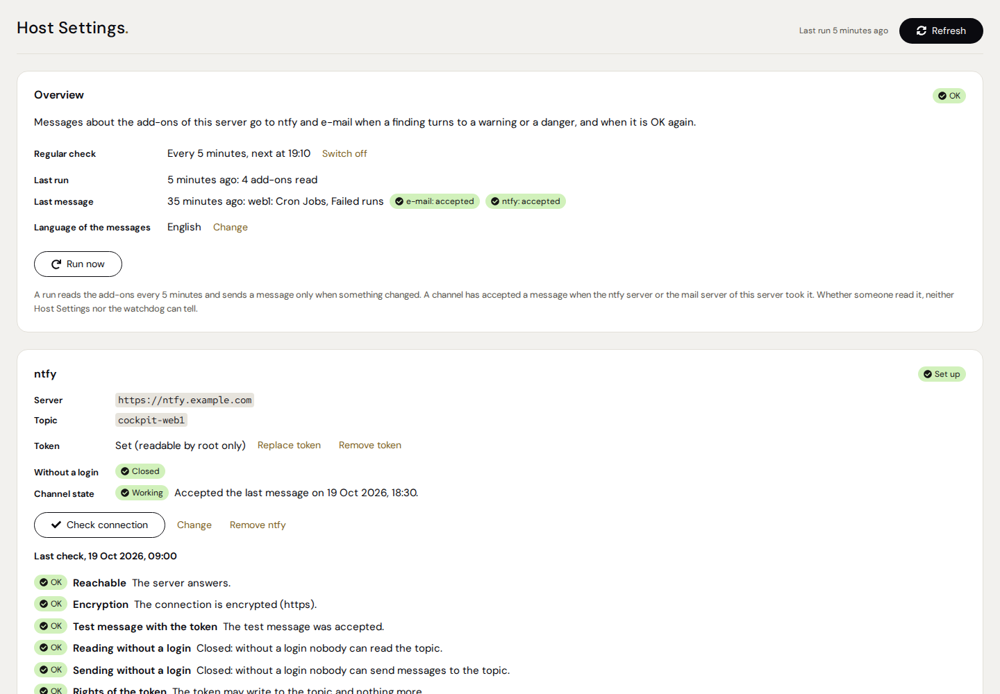
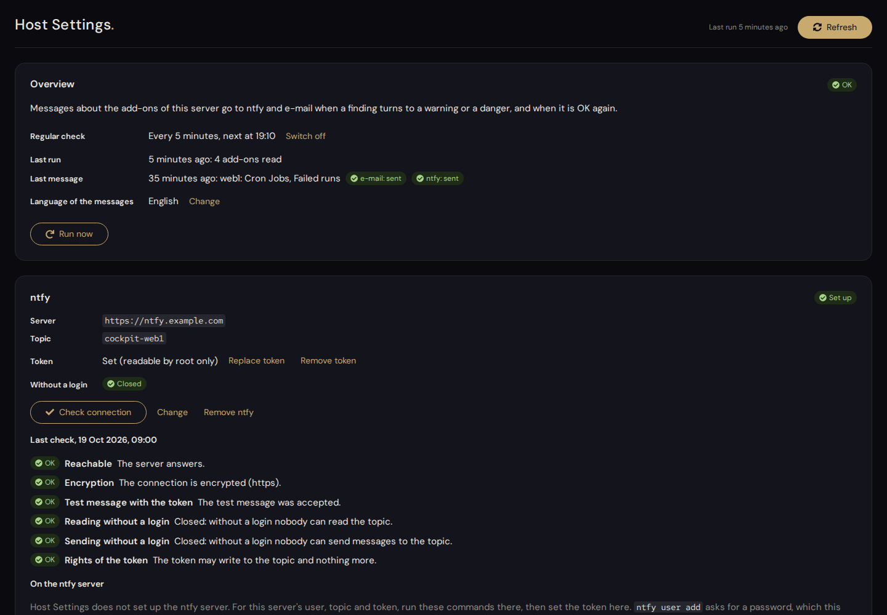
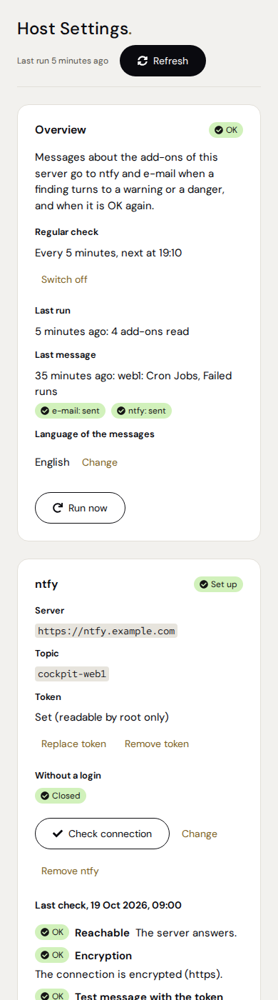
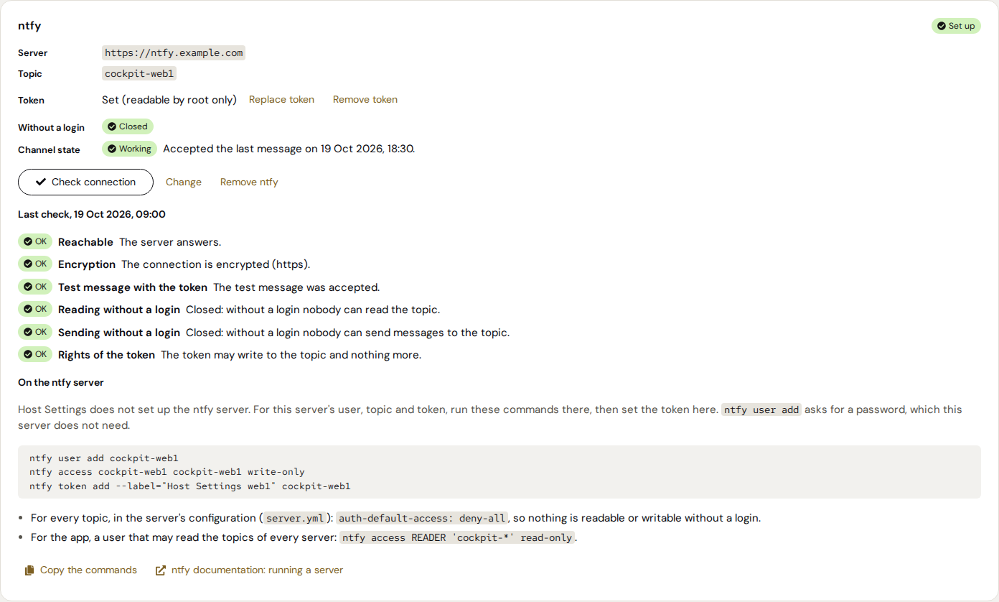
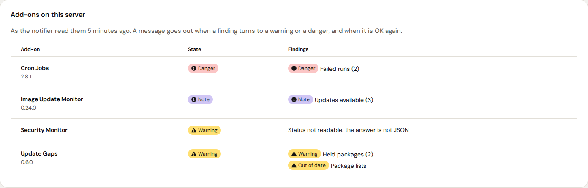
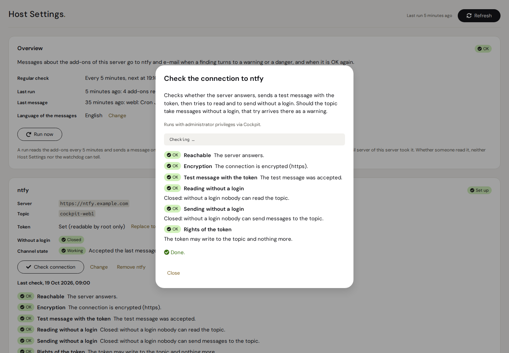

# Host Settings

A [Cockpit](https://cockpit-project.org) add-on that sends a message through
[ntfy](https://ntfy.sh), e-mail or both when an Azentrius add-on on a server needs attention: when
a finding turns to a warning or a danger, and when it is OK again. It reads what
[Cron Jobs](https://github.com/Azentrius/cockpit-cronjobs),
[Image Update Monitor](https://github.com/Azentrius/cockpit-image-update-monitor),
[Update Gaps](https://github.com/Azentrius/cockpit-update-gaps),
[Security Monitor](https://github.com/Azentrius/cockpit-security-monitor) and any other add-on with
the shared status contract report on the same server, the way
[Status Board](https://github.com/Azentrius/cockpit-status-board) shows them.

Host Settings is installed on every server. Its notifier runs as a user of its own, never as
root. The page sets up the channels, shows what the ntfy server needs for this server and checks
that the topic is closed to anyone without a login. It has one tab so far, Notifications; a
second one for Cockpit's own settings (`/etc/cockpit/cockpit.conf`) is planned.



|  |  |
|---|---|
|  |  |

**Contents**

- [What it does](#what-it-does)
- [What it does not do](#what-it-does-not-do)
- [Messages](#messages)
- [How it works](#how-it-works)
- [Security model](#security-model)
- [Requirements](#requirements)
- [Install, update, uninstall](#install-update-uninstall)
- [Setting up](#setting-up)
- [Operation and troubleshooting](#operation-and-troubleshooting)
- [Translations](#translations)
- [Development](#development)
- [Releasing](#releasing)
- [Known limits](#known-limits)
- [License](#license)

---

## What it does

- **Reads every add-on's status** as Status Board does: the same checks of every answer, the same
  states; an item past its `stale_after` counts as a warning, and an add-on whose status cannot be
  read is a warning of its own.
- **Tells changes, finding by finding:** a finding that turns to a warning or a danger, a danger
  that becomes a warning, a finding that is OK again or no longer reported. A second finding in an
  add-on that is already a warning is told as well. Where an add-on lists the single findings
  behind an item (each port reachable from the internet, say), each one is told on its own, also
  while the item stays a danger, and again if it comes back; an accepted finding stays quiet until
  its acceptance ends, and one counts as resolved only when a complete check no longer finds it.
  What cannot be checked is never taken as OK:
  a finding the add-on cannot judge for now, or one missing from an answer that left items out,
  keeps what was told, and an add-on that is no longer installed is told as "no longer checked".
  The same change of the same finding comes at
  most once an hour, so a flapping finding does not flood the phone. The first run after setting
  up sends a summary of what the add-ons report then.
- **ntfy:** any ntfy server, with a token (recommended) or without. Danger comes with a high
  priority, warnings with the default one, "OK again" with a low one.
- **E-mail:** handed to the mail server of the server itself on `localhost:25` (postfix or exim,
  for example), which delivers or relays it.
- **Checks the way to ntfy** ("Check connection"): the server answers, the connection is
  encrypted, the token may publish, the topic is closed to anyone without a login for reading
  and, on request, for sending, and the token may not read.
- **Shows the commands for the ntfy server:** the user, its write access to the topic and the
  token this server needs, ready to copy. Host Settings does not set up the server itself.
- **Knows what the server is expected to check** (its target profile): its roles (`web`,
  `database`, `build`, `bastion`), the add-ons they expect, more add-ons if you add them, and
  single checks left out on purpose, with a reason and, if you like, an end. When an expected
  add-on or check can no longer be checked (not installed, failed, no access, not set up, status
  not readable), one message says so, and one more when it can again. Add-ons the profile does
  not expect give no such message.
- **Reports its own state** through the status contract: Status Board shows whether messages are
  set up, whether the last one went out, whether the topic is closed and when the notifier last
  ran, and reads the server's target profile from it; Cockpit's menu shows it as an icon.

## What it does not do

- It makes no checks of its own: it says only what the add-ons say, and only on its own server.
- Nothing comes while the server is off or cannot reach the ntfy server or its mail server. Status
  Board on the bastion shows such a server as unreachable.
- It does not install, configure or run an ntfy server.
- E-mail needs a mail server that accepts mail on `localhost:25`. A `sendmail` command alone
  (nullmailer, msmtp, dma) is not used.
- It holds no settings of the other add-ons; each keeps its own.

## Messages

A message holds only what the add-ons report, their names and the server's name, in English or
German (a setting on the page). For example:

```
web1: Cron Jobs, Failed runs

Danger · Cron Jobs · Failed runs (2)
backup, mail

Host Settings on web1
```

Several changes in one run come as one message ("web1: 3 changes"). A message that could not go
out on any channel is sent again on the next run.

## How it works

- `cockpit-host-settings-notify.timer` starts the notifier every 5 minutes. It finds the add-ons in
  `/usr/share/cockpit/*/manifest.json` (section `azentrius.status`), runs each status command as
  `COMMAND status --lang en|de`, judges the answers with the rules of Status Board, compares every
  finding with what it told last, sends one message for the changes and writes its state to
  `/var/lib/cockpit-host-settings`.
- "Check connection" and "Send a test message" run in `cockpit-host-settings-test@ntfy.service` and
  `@mail.service`, as the same user as the notifier.
- The page calls only the fixed verbs of `/usr/lib/cockpit-host-settings/host-settings.py`: the
  settings in `/etc/cockpit-host-settings/notify.conf`, the token, the timer, a run now, the checks,
  the target profile in `/etc/cockpit-host-settings/profile.conf`.
- Paths, verbs, formats and every step in detail: [docs/INTERNALS.md](docs/INTERNALS.md).

## Security model

- **The notifier never runs as root.** It runs as the system user `cockpit-host-settings`, hardened
  (`systemd-analyze security`: 1.5), and may write only its state. A status command runs only when
  it lies below `/usr/lib/cockpit-NAME/` and it and its folders belong to root and nobody else can
  change them.
- **The token** goes from the page to the helper on standard input, lands in
  `/etc/cockpit-host-settings/ntfy.token` (root, 0600), and reaches the notifier as a systemd
  credential (`LoadCredential=`). It leaves the server only as the `Authorization` header of a
  request to the ntfy server set up; redirects are not followed. The page never shows it.
- **The page** changes something only through its dialog, with administrative access. Everything an
  add-on reports reaches the page and the messages as text, cut and cleaned of control and
  bidirectional characters.
- **Sending without a login** is tried only when you press "Check connection" (the page says so
  first); should the topic accept it, that message itself is the warning.
- **The target profile** is readable by everyone (0644): Status Board and the status verb read it
  without root. It holds roles, add-on and check names and the reasons you write, nothing secret.
  Only root changes it, through the helper's fixed verbs; the page does so only through its dialog.

## Requirements

- Cockpit 264 or newer, Python 3.8 or newer, systemd 247 or newer (`LoadCredential=`), `ss`
  (iproute2).
- For e-mail: a mail server listening on `localhost:25`. The RHEL rebuilds do not install one as
  they come: `sudo dnf install postfix && sudo systemctl enable --now postfix` delivers locally.
- For ntfy: an ntfy server the server can reach. With `auth-default-access: deny-all` on that
  server and a token for this server's user, nobody else can read or send to its topic.

### Supported systems

What CI really runs, and what is expected but not tested. A package that installs is not a tested
system by itself.

| | Systems | What is checked |
|---|---|---|
| **Tested** | Ubuntu 24.04 (GitHub runner) with systemd, ntfy 2.32 in Docker and postfix | the package with its real units, listed by Cockpit (job `e2e`): the page's commands on the ntfy server as shown, "Check connection" against a topic closed without a login and an open one, the first run's summary through ntfy and e-mail, a change told once, a run without a change silent, a target profile's gaps and an expected add-on that goes away told once each, the status as `nobody` with the profile, switching off, the token in no file but its own and in no log, removing the package |
| **Tested** | Rocky Linux 9.8 and 10.2 (for RHEL 9 and 10) in a VM with SELinux enforcing, ntfy 2.32 in Podman and postfix | the same as job `e2e`, with the `.rpm` and the distribution's Cockpit, and no SELinux denial from before the install to after the removal (job `e2e-el`, `tools/vm.sh`) |
| **Tested** | Python 3.8 and 3.12 | the notifier, the helper and the status against Status Board's own test answers (job `python-min` and `make check`) |
| **Checked** | four Ubuntu servers (24.04 and 26.04) | the status verbs of Cron Jobs, Image Update Monitor, Update Gaps and Security Monitor answer as an unprivileged user without network |
| **Package installs** | Debian 13 (`.deb`), Fedora 43 (`.rpm`) (job `test`); Rocky Linux and AlmaLinux 9 and 10 (`.rpm`, for RHEL 9 and 10; job `install`) | the package installs with the distribution's own dependencies, creates its user, runs the notifier as that user, answers the status as `nobody` and removes cleanly. No Cockpit or systemd runs there. |
| **Expected, untested** | Debian 12 and 13, Ubuntu 22.04 and newer, Fedora, RHEL 9 and newer, with Cockpit 264 or newer | the page in a real Cockpit there |

## Install, update, uninstall

Install it on every server that should send messages.

**From the Azentrius package repository** (Debian, Ubuntu, Fedora, RHEL). Set up
[packages.azentrius.com](https://packages.azentrius.com) once:

```bash
# Debian and Ubuntu
curl -fsSLO https://packages.azentrius.com/azentrius-repository.deb
sudo apt install ./azentrius-repository.deb
sudo apt update

# Fedora and RHEL
sudo rpm --import https://packages.azentrius.com/azentrius.asc
sudo dnf install https://packages.azentrius.com/azentrius-repository.rpm
```

Then install **Host Settings** in Cockpit under **Applications** (with administrative access), or
on the console with `sudo apt install cockpit-host-settings` or
`sudo dnf install cockpit-host-settings`. The system's updates keep it current. The repository
takes a package only after checking that this repository's release workflow built it, and signs
it. Which systems are tested how: [Supported systems](#supported-systems).

**From the files of a release.** Every
[release](https://github.com/Azentrius/cockpit-host-settings/releases) has the `.deb` and the
`.rpm`, `SHA256SUMS` and a signed build provenance. Download the package for your system and
`SHA256SUMS`, check that the download is complete and that this repository's release workflow
built it, then install it:

```bash
sha256sum --ignore-missing -c SHA256SUMS
gh attestation verify cockpit-host-settings_X.Y.Z-1_all.deb --repo Azentrius/cockpit-host-settings
sudo apt install ./cockpit-host-settings_X.Y.Z-1_all.deb    # or: sudo dnf install ./cockpit-host-settings-X.Y.Z-1.noarch.rpm
```

To update, install the package of a newer release the same way.

**From the source.** Build the packages yourself with `make packages` (needs dpkg-deb and rpmbuild)
and install the one for your system from `dist/`.

The package creates the user `cockpit-host-settings`, an empty token file and the state folder;
the regular check stays off until it is set up on the page.

**Uninstall:** `sudo apt remove cockpit-host-settings` or `sudo dnf remove cockpit-host-settings`.
Removing the package removes its state and keeps the settings, the token and the user.

## Setting up

1. **ntfy:** "Set up ntfy" with the server's address and a topic (the page suggests
   `cockpit-<server name>`). On the ntfy server, run the commands the page shows:

   ```bash
   ntfy user add cockpit-web1
   ntfy access cockpit-web1 cockpit-web1 write-only
   ntfy token add --label="Host Settings web1" cockpit-web1
   ```

   and set the token on the page. For the ntfy app, a user that may read the topics of every
   server: `ntfy access READER 'cockpit-*' read-only`. "Check connection" then shows whether
   everything is as it should be.
2. **E-mail:** "Set up e-mail" with a recipient, then "Send a test message".
3. **The regular check:** "Set up the regular check". The first run sends the summary.
4. **The target profile** (optional): "Set up a profile" under Target profile, and choose the
   server's roles. Every server is expected to have Host Settings, Update Gaps, Security Monitor
   and Cron Jobs; the roles add to that:

   | Role | Also expected |
   |---|---|
   | `web` | Image Update Monitor |
   | `database` | Image Update Monitor |
   | `build` | nothing more |
   | `bastion` | nothing more that reports a status (Status Board, which runs there, has no status of its own) |

   For example, four servers with their roles:

   | Server | Role | Expected |
   |---|---|---|
   | web1 | `web` | Host Settings, Update Gaps, Security Monitor, Cron Jobs, Image Update Monitor |
   | web2 | `web` | the same |
   | bastion | `bastion` | Host Settings, Update Gaps, Security Monitor, Cron Jobs |
   | ci1 | `build` | the same |

   The same on the console, with administrative access (each change keeps the file as it was in
   `profile.conf.bak`):

   ```bash
   sudo /usr/lib/cockpit-host-settings/host-settings.py profile roles web       # web1, web2
   sudo /usr/lib/cockpit-host-settings/host-settings.py profile roles bastion   # bastion
   sudo /usr/lib/cockpit-host-settings/host-settings.py profile roles build     # ci1
   # more than the roles expect: an add-on, or one check of an add-on
   sudo /usr/lib/cockpit-host-settings/host-settings.py profile expect add security/exposure
   # a check left out on purpose (always add-on/check, never an add-on alone), until a day if
   # you like; the reason on standard input
   echo "CrowdSec instead" | sudo /usr/lib/cockpit-host-settings/host-settings.py profile skip add security/fail2ban
   echo "network data off for now" | sudo /usr/lib/cockpit-host-settings/host-settings.py profile skip add update-gaps/cve 2026-12-31
   /usr/lib/cockpit-host-settings/host-settings.py profile show
   ```

   The next run of the notifier tells once what cannot be checked right now. Without a profile,
   Status Board counts every installed add-on as expected and says the server has no target
   profile.



## Operation and troubleshooting

- The state of the last run: the page, or `sudo /usr/lib/cockpit-host-settings/host-settings.py show`.
- The log: `journalctl -u cockpit-host-settings-notify.service`.
- A run now: "Run now" on the page, or `sudo systemctl start cockpit-host-settings-notify.service`.
- The status for the board: `/usr/lib/cockpit-host-settings/host-settings.py status --lang en`
  (with the target profile under `profile`).
- The target profile: the page, or `/usr/lib/cockpit-host-settings/host-settings.py profile show`;
  `sudo … profile remove` takes it away again.
- Switching off: "Switch off" on the page (`host-settings.py remove timer`); Status Board then shows
  Host Settings as switched off.
- A topic shown as open: set `auth-default-access: deny-all` on the ntfy server and give the
  server's user write access to its topic only, then "Check connection" again.

## Translations

The page, the messages and the status come in English and German (with "Sie"). The page follows
Cockpit's language; the messages follow the setting on the page. The texts are in
`plugin/i18n.js`, `lib/hsnotify.py` (messages) and `lib/hsstatus.py` (status); the tests check that
every key exists in both languages and that the English page contains no German.

## Development

See [CONTRIBUTING.md](CONTRIBUTING.md). In short:

```bash
pip install -r test/requirements.txt   # pinned check tools: shellcheck, ruff, playwright
make check                             # every offline test (installs jsdom in test/ first)
make lint                              # shellcheck, ruff, systemd-analyze for the units
make packages                          # .deb and .rpm in dist/
python3 tools/preview/build.py         # the page with made-up data: tools/preview/out/host-settings/index.html?scenario=ready
python3 tools/preview/shoot.py         # screenshots (light, dark, phone) to docs/img; needs Playwright
```

The screenshots in `docs/img` come from the CI artifact `screenshots` of the test workflow.

## Releasing

1. Set the new version in `plugin/settings.js` (`const VERSION`) and in every `?v=` in
   `plugin/index.html`, and give the section in `CHANGELOG.md` its date, `## X.Y.Z – YYYY-MM-DD`
   (`tools/check-version.sh` checks that the three agree).
2. Merge to `main`.
3. On GitHub: Actions › **release** › Run workflow (branch `main`). The workflow checks the version,
   waits for the test workflow of that commit to pass, runs the tests, builds the `.deb`, the `.rpm`
   and the source archive `cockpit-host-settings-X.Y.Z.tar.gz` with `SHA256SUMS` and a signed build
   provenance, and creates the tag `vX.Y.Z` with a release whose notes come from `CHANGELOG.md`.
4. packages.azentrius.com takes the packages from the release within an hour
   ([Azentrius/packages](https://github.com/Azentrius/packages)); it leaves pre-releases out.

## Known limits

- Only add-ons on the same server, and only those that report through the status contract.
- E-mail goes only to a mail server on `localhost:25`; a `sendmail` command alone is not used,
  because the notifier's sandbox ignores the setgid bit postfix' `postdrop` needs.
- An add-on that answers its status verb with exit 77 (nothing readable without root) gives no
  message, and what was told about it before stays as it was, since nothing of it can be checked.
  Status Board shows it as a warning, "No access". When the target profile expects that add-on,
  one message says its check is no longer possible.
- The roles are a fixed catalog; a role this version does not know makes the line `roles` not
  count (the page names it). Status Board on the bastion cannot be expected: it has no status of
  its own.
- "Check connection" is tested against ntfy 2.32 and was against 2.11 before; it reads a topic
  with `poll=1&since=1m`, which older and newer servers know as well.
- The tab for Cockpit's own settings is not there yet.

## License

Apache-2.0, see [LICENSE](LICENSE). Third-party material (the fonts DM Sans, DM Serif Display and
Red Hat Mono, the icons from Font Awesome Free) keeps its own license and is listed in
[NOTICE](NOTICE); the test answers in `test/fixtures/board` come from Status Board under the same
license. The page contains no code from Cockpit; it uses Cockpit's API `cockpit.js` at runtime,
which Cockpit itself ships.

Please report security issues privately, see [SECURITY.md](SECURITY.md).

Made by [Azentrius](https://azentrius.com).
